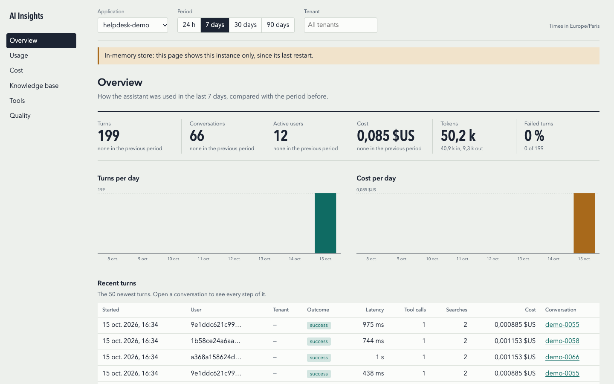
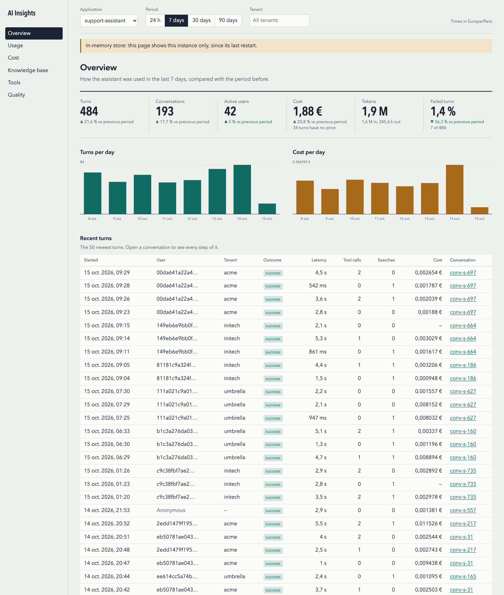

# spring-ai-insights

You shipped a Spring AI assistant. Now you need to know who uses it, what it costs, which tools and
knowledge bases it relies on, and where it fails. Spring AI's built-in observations give you spans
and token counters, but no per-user view, no cost, and no single record per question.

`spring-ai-insights` is a Spring Boot starter that records **one turn per ChatClient call** with
everything that happened inside it. Design and roadmap: [design.md](design.md).

## What you get

Every `ChatClient` call (blocking or streaming) becomes a `ConversationTurn`:

- **who**: user ID (pseudonymised by default) and tenant, from Spring Security or advisor params
- **conversation**: conversation ID, outcome (`SUCCESS`, `ERROR`, `CANCELLED`), latency, time to first token, finish reasons
- **model calls**: provider, model, input / output / cache-read / cache-write tokens, cost per call
- **tool calls**: name, duration, outcome (a tool that throws is a failed call, even when Spring AI passes the
  error message back to the model); **retrievals**: vector store, top-k, result count, scores, document IDs
- **cost**: total cost of the turn in your configured currency
- **your attributes**: any key you pass as an advisor param (feature, channel, A/B variant…)

Turns go to a store (your MongoDB, or a bounded in-memory store) through an asynchronous writer:
recording never blocks or breaks a chat. Micrometer metrics (all tagged with `application`):

| Metric | Extra tags |
|---|---|
| `ai.insights.turns` | `outcome`, `streaming` |
| `ai.insights.tokens` | `model`, `type` (`input`, `output`, `cache_read`, `cache_write`) |
| `ai.insights.cost` | `model`, `currency` (and `tenant` if enabled) |
| `ai.insights.tool.calls` | `tool`, `outcome` |
| `ai.insights.retrievals` | `store`, `result` (`hit`, `empty`) |
| `ai.insights.ttft` (timer) | – |
| `ai.insights.events.dropped`, `ai.insights.store.errors`, `ai.insights.internal.errors` | – |
| `ai.insights.turns.stalled` | – (finished turns whose model call never reported its usage; recorded without it) |
| `ai.insights.unpriced.models` | `model` |
| `ai.insights.feedback` | `rating` (`up`, `down`) |

User and conversation IDs are **never** metric tags (unbounded cardinality); they live in the turn records.

## Quickstart (5 minutes)

Requirements: Java 21, Spring Boot 4.1, Spring AI 2.0.

1. Add the starter. It is not on Maven Central yet; until the first release, clone this repository
   and use a Gradle composite build:

   ```kotlin
   // settings.gradle.kts
   includeBuild("../spring-ai-insights")
   // build.gradle.kts
   implementation("io.github.springaiinsights:spring-ai-insights-starter:0.1.0-SNAPSHOT")
   ```

2. Set a pseudonymisation secret (from your secret store, not from Git):

   ```yaml
   ai-insights:
     identity:
       secret: ${AI_INSIGHTS_SECRET}
   ```

   Without it, user IDs are pseudonymised with a random key that changes on every restart, and a warning is logged.

3. Declare your model prices (per 1,000,000 tokens). `model` matches the reported model ID exactly,
   or as a substring (the longest match wins), so one entry covers regional prefixes such as `eu.`:

   ```yaml
   ai-insights:
     pricing:
       currency: USD
       models:
         - model: anthropic.claude-sonnet-4
           input: 3.00
           output: 15.00
           cache-read: 0.30
           cache-write: 3.75
         - model: gpt-4o
           input: 2.50
           output: 10.00
           cache-read: 1.25
           input-includes-cached: true   # OpenAI counts cached tokens inside input tokens
   ```

   Because of substring matching, `gpt-4o` also matches `gpt-4o-mini`. List every model you use,
   so the more specific entry (`gpt-4o-mini`) wins over the shorter one.

   Models without a price are still recorded, with a `null` cost, one warning, and the `ai.insights.unpriced.models` counter.

4. Use the auto-configured `ChatClient.Builder` as usual. The advisor is added for you:

   ```java
   @Service
   class Assistant {
       private final ChatClient chat;
       Assistant(ChatClient.Builder builder) { this.chat = builder.build(); }
   }
   ```

## Try the demo

The repository has a helpdesk assistant that uses the starter: a help center searched with
`QuestionAnswerAdvisor`, three tools (`lookupOrder`, `serviceStatus`, `openTicket`), streaming, and
feedback. Answers are simulated, so it needs no API key and costs nothing. Twelve simulated customers
send it questions every two seconds, so the dashboard fills up within a minute.

```bash
./gradlew :spring-ai-insights-demo:run
```

Open <http://localhost:8080/ai-insights/> and sign in as `admin` / `admin`. To ask a question yourself:

```bash
curl -u alice:alice -H 'Content-Type: application/json' \
  -d '{"conversationId":"c1","question":"Where is my order #10423?"}' \
  localhost:8080/api/chat
```

The answer includes a `turnId`. Your turn appears on the dashboard next to the generated traffic.
Prometheus metrics are at <http://localhost:8080/actuator/prometheus>.



The other pages: [usage](docs/images/demo-usage.png), [cost](docs/images/demo-cost.png),
[knowledge base](docs/images/demo-knowledge.png), [tools](docs/images/demo-tools.png),
[quality](docs/images/demo-quality.png) and [one conversation](docs/images/demo-conversation.png).

To run it against a real model, add a Spring AI model starter to `demo/build.gradle.kts` (for example
`org.springframework.ai:spring-ai-starter-model-openai` with `spring.ai.openai.api-key`), delete
`SimulatedChatModel.java`, and set `demo.traffic.enabled=false` unless you want to pay for the generated
questions. Pricing for `gpt-4o` and `gpt-4o-mini` is already configured in `demo/src/main/resources/application.yml`.
The demo's tests rely on the simulated model, so once it is gone build with
`./gradlew build -x :spring-ai-insights-demo:test` (or delete `demo/src/test`).

## Passing context

```java
ChatClientResponse response = chat.prompt()
    .user(question)
    .advisors(a -> a
        .param(ChatMemory.CONVERSATION_ID, conversationId)          // groups turns into a conversation
        .param(InsightsContextKeys.ATTRIBUTE_PREFIX + "feature", "refunds")   // becomes attribute feature=refunds
        .param(InsightsContextKeys.USER_ID, userId)                  // overrides the resolved user
        .param(InsightsContextKeys.TENANT_ID, tenantId))             // overrides the resolved tenant
    .call()
    .chatClientResponse();

String turnId = (String) response.context().get(InsightsContextKeys.TURN_ID);   // link feedback or logs to this turn
```

Without a conversation ID, each turn gets a random one and is flagged `conversationIdMissing`.
With streaming, every `ChatClientResponse` chunk carries the turn ID in its context.

**Identity.** With Spring Security on the classpath, the user is `Authentication.getName()` and
the tenant is the `ai-insights.identity.tenant-claim` claim when the principal is a `Jwt`. Unauthenticated
and anonymous requests are recorded without a user. Advisor params always win. In WebFlux apps, the
security context lives in the Reactor context, not on the thread: pass `USER_ID` / `TENANT_ID`
as params or provide your own `InsightsIdentityResolver` bean.

## ChatClients you build yourself

Clients from the auto-configured `ChatClient.Builder` are covered. For a client you build by hand,
add the advisor and **pass the `ObservationRegistry`**, so model, tool and retrieval calls are attributed to the turn:

```java
ChatClient chat = ChatClient.builder(chatModel, observationRegistry, null, null)
    .defaultAdvisors(insightsAdvisor)      // inject InsightsAdvisor
    .build();
```

`ChatClient.create(chatModel)` has no observation registry: turns are still recorded, but only with
the token usage of the final response, provider `unknown`, and no tool or retrieval details.

## Knowledge bases

Every `similaritySearch` on a `VectorStore` is recorded as a retrieval: which store, how many chunks,
and which documents. A document is identified by its `source` metadata (the file or S3 URI most
loaders and Amazon Bedrock Knowledge Bases set), else by the chunk ID; several chunks of one document
count as one hit. Change the key with `ai-insights.knowledge.document-key`.

Stores that emit no observation themselves are observed too, and keep their type, so you can still
inject them by their class. A `final` store class, such as `BedrockKnowledgeBaseVectorStore`, cannot be
subclassed and is wrapped instead: inject it as `VectorStore`. Turn this off with
`ai-insights.knowledge.observe-stores=false`.

To also see documents that are **never** retrieved in an Amazon Bedrock Knowledge Base, add
`spring-ai-insights-bedrock` (it brings the AWS SDK `bedrockagent` client) and list the knowledge bases:

```kotlin
implementation("io.github.springaiinsights:spring-ai-insights-bedrock:0.1.0-SNAPSHOT")
```

```yaml
ai-insights:
  knowledge:
    bedrock:
      knowledge-base-ids: KB12345678
      region: eu-west-1   # optional, else spring.ai.bedrock.aws.region, else the AWS SDK default
```

The documents are listed at startup and every hour with the Bedrock Agent API
(`bedrock:ListDataSources` and `bedrock:ListKnowledgeBaseDocuments`); a `BedrockAgentClient` bean is
used when you define one. Missing credentials or region never fail startup: failures are logged, each
knowledge base keeps its previous list, and listing is retried at the next refresh.

For other stores, define a `KnowledgeCorpusCatalog` bean: its `store()` is the store name shown on
the Knowledge base page, and `documentIds()` returns the IDs the `document-key` metadata takes
(`null` while not loaded yet).

## Storage

With Spring Data MongoDB configured in your app (`spring-boot-starter-data-mongodb`, MongoDB 5.0 or
later), turns are stored in **your** database; nothing else to run. Otherwise they stay in memory.

| | MongoDB | In memory |
|---|---|---|
| Chosen when | a single `MongoOperations` bean exists (`store=auto`) or `store=mongodb` | no MongoDB, or `store=memory` |
| Survives restarts | yes | no |
| Retention | TTL index on `startedAt`, `ai-insights.retention` (90 days) | `memory.max-turns` newest turns |
| Collection | `ai_insights_turns` (prefix configurable) | – |

With `store=mongodb` and no MongoDB configured, startup fails. With a persistent store,
`ai-insights.identity.secret` is **required** (startup fails without it): otherwise pseudonymised
user IDs would change at every restart. If MongoDB is down, chats keep working; failed writes are
counted in `ai.insights.store.errors`.

Indexes are created on first write. Changing `retention` updates the TTL index on the next start
(the `readWrite` role is enough).

## Analytics API

The store also answers questions about usage. Inject `InsightsAnalytics`:

```java
var filter = new InsightsFilter("support-bot", from, to, null, ZoneId.of("Europe/Paris"));

UsageSummary summary = analytics.summary(filter);       // turns, conversations, active users, tokens, cost, errors…
List<TimeBucket> daily = analytics.timeline(filter, Granularity.DAY);
List<ModelUsage> models = analytics.models(filter);     // tokens and cost per model
List<ToolUsage> tools = analytics.tools(filter);        // calls, errors, avg duration, repeated calls
List<RetrievalUsage> kb = analytics.retrievals(filter); // per vector store: queries, empty results, avg top score
List<UserUsage> top = analytics.topUsers(filter, 10);
List<TenantUsage> tenants = analytics.tenants(filter);
List<ConversationTurn> chat = analytics.conversation("support-bot", conversationId);
```

Costs only add up priced model calls; `unpricedTurns` tells you how many turns are incomplete.

## Dashboard

In a servlet web application, the starter serves a dashboard at **`/ai-insights/`**: overview, usage
(daily/weekly/monthly active users, new users, busiest hours), cost (per model, tenant and user,
month-end projection), knowledge base (searches, empty results, most and least returned documents,
documents never returned), tools (most to least used, errors, p95 duration, repeated calls, tools
offered but never called), quality (ratings, failures, latency, finish reasons, abandoned
conversations) and a timeline of each conversation. Filter by application, period (24 h to 90 days) and tenant.



**Access.** The dashboard uses **your application's own login**. It does not add a security filter
chain: whatever authenticates your users (form login, OAuth2 login, JWT resource server) also
authenticates the dashboard, and an anonymous browser gets your usual login redirect. A signed-in
user also needs the role `ai-insights.dashboard.role` (`AI_INSIGHTS`, checked with
`request.isUserInRole`, so the authority is `ROLE_AI_INSIGHTS`); otherwise the answer is `403`.
Access fails closed: a request that reaches the dashboard unauthenticated (for example because
your chain permits every path) gets `401`, never data.

With a JWT resource server, map a claim to the role, for example a `roles` claim:

```java
@Bean
JwtAuthenticationConverter jwtAuthenticationConverter() {
    var authorities = new JwtGrantedAuthoritiesConverter();
    authorities.setAuthoritiesClaimName("roles");   // ["AI_INSIGHTS", ...]
    authorities.setAuthorityPrefix("ROLE_");
    var converter = new JwtAuthenticationConverter();
    converter.setJwtGrantedAuthoritiesConverter(authorities);
    return converter;
}
```

Without Spring Security the dashboard is **off**, unless you set `ai-insights.dashboard.allow-anonymous=true`
(local development only: anyone who reaches the port sees the data).

- Change the URL with `ai-insights.dashboard.path` (for example `/ops/ai`); feedback moves with it.
- With the in-memory store the dashboard shows **this instance only, since its last restart**, and
  says so in a banner. Use MongoDB to see every instance.
- The UI is a few static files inside the jar: no CDN, no web fonts, no `innerHTML`, and a strict
  `Content-Security-Policy`. API responses are never cached.
- **WebFlux** applications get no dashboard or feedback endpoint; use the `InsightsAnalytics` API
  and the `InsightsFeedback` bean directly.
- **Abandoned conversations** are those whose last turn failed, was cancelled or was rated not
  helpful, and that then stayed idle for `ai-insights.quality.abandoned-after` (30 minutes). A
  conversation with a later turn, even outside the period, is not abandoned.
- **Trace links.** With Micrometer Tracing, each turn records its trace ID. Set
  `ai-insights.dashboard.trace-url` (for example `https://grafana.example.com/explore?traceId={traceId}`)
  to link each turn of a conversation to its trace.
- Try it with generated data: `./gradlew :spring-ai-insights-web:previewDashboard`, then open
  http://localhost:8089/ai-insights/.

## Weekly report

Every Monday at 08:00, a short summary of last week goes to Slack and/or by email, for people who
never open the dashboard: active users, conversations, cost and cost per conversation, positive
feedback, knowledge-base queries with no result, the top five tools, each compared with the week
before, and the projected cost for the month.

```yaml
ai-insights:
  report:
    slack-webhook: ${SLACK_WEBHOOK}          # a Slack incoming webhook
    email-to: [cto@example.com, product@example.com]
    email-from: ai-insights@example.com
    dashboard-url: https://app.example.com/ai-insights/
    zone: Europe/Paris
```

- **The webhook URL is a secret.** Set it from an environment variable or your secret store; it is
  never logged, even when Slack is unreachable.
- **Email** needs `spring-boot-starter-mail` and `spring.mail.*`; without a `JavaMailSender`,
  startup fails.
- **Sent once**, however many instances run: with MongoDB, the first instance to claim the week
  sends it. With the in-memory store, each instance sends its own; with your own store, implement
  `ReportLock` on it or declare a `ReportLock` bean.
- The week is the seven calendar days before the run, in `zone`. Each application sends its own
  report, covering all tenants. A failing channel never stops the other one, nor the application.
- Read it any time, behind the dashboard's access check: `GET {path}/report` (HTML) and
  `GET {path}/api/report` (JSON); add `?app=` for another application.

## Feedback

Let users rate an answer with thumbs up or down. Every turn has an ID; send it to your front end
with the answer:

```java
ChatClientResponse response = chat.prompt().user(question).call().chatClientResponse();
String turnId = (String) response.context().get(InsightsContextKeys.TURN_ID);
return new Answer(response.chatResponse().getResult().getOutput().getText(), turnId);
```

When streaming, every chunk carries the turn ID; read it from the first one
(`chat.prompt()...stream().chatClientResponse()`).

The front end posts the rating to `{dashboard.path}/feedback`, as the signed-in user:

```js
await fetch('/ai-insights/feedback', {
  method: 'POST',
  headers: { 'Content-Type': 'application/json', 'X-XSRF-TOKEN': csrfToken },
  body: JSON.stringify({ turnId, rating: 'down', comment: 'The refund policy is outdated' })
});
```

`rating` is `up` or `down`; `comment` is optional (at most 1000 characters). A new rating of the
same turn replaces the previous one.

| Status | When |
|---|---|
| `204` | stored |
| `400` | invalid body (missing `turnId`, unknown rating, comment too long) |
| `401` | no signed-in user |
| `404` | unknown turn, **or a turn of another user** (same answer, so turn IDs reveal nothing) |
| `503` | the store failed |

Only the user who asked can rate a turn: the endpoint compares the principal name with the turn's
user. The endpoint is a normal `POST` in your security chain, so **CSRF protection applies**: send
your CSRF token as you do for your other `POST`s (stateless JWT APIs usually have CSRF disabled).

If your turns are not recorded under the principal name (you pass `InsightsContextKeys.USER_ID`,
or use your own `InsightsIdentityResolver`), call the Java API with the same raw user ID instead:

```java
boolean saved = insightsFeedback.submit(turnId, userId, Rating.UP, comment);  // false: unknown turn or other user
```

With the in-memory store, a rating must reach the instance that recorded the turn (one instance or
sticky sessions); otherwise it gets `404`. Use MongoDB when several instances serve the chat.

Ratings appear on the Quality page, next to each turn of a conversation, and in the
`ai.insights.feedback` counter. Turn the endpoint off with `ai-insights.feedback.enabled=false`.

## Configuration

| Property | Default | |
|---|---|---|
| `ai-insights.enabled` | `true` | |
| `ai-insights.application` | `spring.application.name`, else `default` | `application` tag and turn field |
| `ai-insights.store` | `auto` | `auto`, `mongodb` or `memory` |
| `ai-insights.retention` | `90d` | how long a persistent store keeps turns (at least 1 minute) |
| `ai-insights.mongodb.collection-prefix` | `ai_insights_` | collection name prefix |
| `ai-insights.capture.stall-timeout` | `30s` | how long a finished turn waits for its model call's usage before it is recorded without it |
| `ai-insights.capture.reactor-context-propagation` | `true` | turn on Reactor's automatic context propagation (JVM-wide), so searches and tool calls Spring AI runs on other threads during a streamed turn count in that turn |
| `ai-insights.capture-content` | `false` | record prompt and answer text |
| `ai-insights.identity.pseudonymise` | `true` | HMAC-SHA256 user IDs |
| `ai-insights.identity.secret` | – | HMAC key; required with a persistent store |
| `ai-insights.identity.tenant-claim` | `tenant_id` | JWT claim holding the tenant |
| `ai-insights.knowledge.document-key` | `source` | chunk metadata identifying the document; chunk ID when absent |
| `ai-insights.knowledge.observe-stores` | `true` | wrap vector stores that emit no observation |
| `ai-insights.knowledge.bedrock.knowledge-base-ids` | – | Bedrock Knowledge Bases whose documents are listed |
| `ai-insights.knowledge.bedrock.region` | `spring.ai.bedrock.aws.region`, else SDK default | region of those knowledge bases |
| `ai-insights.knowledge.bedrock.refresh` | `1h` | how often the document list is refreshed (≥ 1m) |
| `ai-insights.pricing.currency` | `USD` | |
| `ai-insights.pricing.models[]` | – | `model`, `input`, `output`, `cache-read`, `cache-write`, `input-includes-cached` |
| `ai-insights.metrics.tenant-tag` | `false` | tag `ai.insights.cost` with tenant (only for a few tenants) |
| `ai-insights.writer.queue-capacity` | `10000` | turns waiting to be stored; overflow is dropped and counted |
| `ai-insights.memory.max-turns` | `10000` | in-memory store size; oldest evicted first |
| `ai-insights.dashboard.enabled` | `true` | serve the dashboard (servlet apps) |
| `ai-insights.dashboard.path` | `/ai-insights` | dashboard URL; the feedback endpoint is `{path}/feedback` |
| `ai-insights.dashboard.role` | `AI_INSIGHTS` | role required to open the dashboard |
| `ai-insights.dashboard.allow-anonymous` | `false` | open the dashboard to anyone (local development only) |
| `ai-insights.dashboard.trace-url` | – | link to a turn's trace: an http(s) URL containing `{traceId}` |
| `ai-insights.quality.abandoned-after` | `30m` | idle time before a conversation can count as abandoned (≥ 1m) |
| `ai-insights.feedback.enabled` | `true` | serve `POST {path}/feedback` |
| `ai-insights.report.enabled` | `true` | send the weekly report when a channel is configured |
| `ai-insights.report.cron` | `0 0 8 * * MON` | when the report is sent (Spring cron, in `zone`) |
| `ai-insights.report.zone` | JVM zone | time zone of the report's days and of `cron` |
| `ai-insights.report.slack-webhook` | – | Slack incoming webhook URL (secret) |
| `ai-insights.report.email-to` | – | email recipients (needs `spring-boot-starter-mail`) |
| `ai-insights.report.email-from` | mail server default | email sender address |
| `ai-insights.report.dashboard-url` | – | dashboard link included in the report |

Every bean is `@ConditionalOnMissingBean`: replace the store (`InsightsEventStore`), the identity
resolver (`InsightsIdentityResolver`), or the pricing (`PriceCatalog`) with your own.

## Privacy defaults

- User IDs are pseudonymised (HMAC-SHA256) before they are stored. Set a stable secret to keep them stable across restarts.
- Prompt and answer text is **not** recorded unless `ai-insights.capture-content=true`.
- No user or conversation ID ever becomes a metric tag.
- Spring AI's own traces are separate: its vector-store spans carry the search query. See the
  [observability guide](docs/opentelemetry.md#what-leaves-your-application) before exporting them.

## Observability backends

The starter's Micrometer metrics (`ai.insights.*`) and Spring AI's traces can go to the monitoring
tools you already run:

- **Prometheus and Grafana**: a ready-made
  [Grafana dashboard](observability/grafana/ai-insights-dashboard.json) (usage, cost and tokens per
  model, tools, knowledge bases, time to first token, data health) and
  [Prometheus alert rules](observability/prometheus/ai-insights-alerts.yml) (cost spike, failing
  tools, empty retrievals, slow first token, lost events). Both are tested against a real
  Prometheus and Grafana.
- **OpenTelemetry**: Langfuse, Arize Phoenix, SigNoz, Datadog or any OTLP backend, with
  `spring-boot-starter-opentelemetry`.

See the [observability guide](docs/opentelemetry.md) for the configuration of each backend.

## Roadmap

- **Release**: the first Maven Central release. Publishing is set up; see [RELEASING.md](RELEASING.md).
- A dashboard for WebFlux applications.
